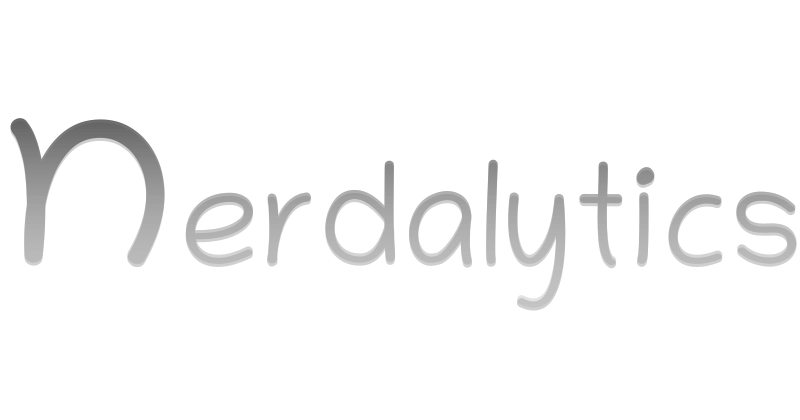

<!---
nerdalytics/nerdalytics is a ✨ special ✨ repository because its `README.md` (this file) appears on your GitHub profile.
--->

# Hi, I'm nerdalytics

I'm an Expert Lead at [nexum AG](https://nexum.com) and own Claude Code for 60+ colleagues there.

### After hours

I'm a nerd and an AI enthusiast. I manage the Qwen squad on daily.dev every day.

[Join the Qwen squad on daily.dev](https://dly.to/YNssJWFodpE)

### At home

I'm married and dad to a cat and a dog.

### Side notes

I play console games and DJ. I'm also a Ford Mustang fan.

### Elsewhere

  

